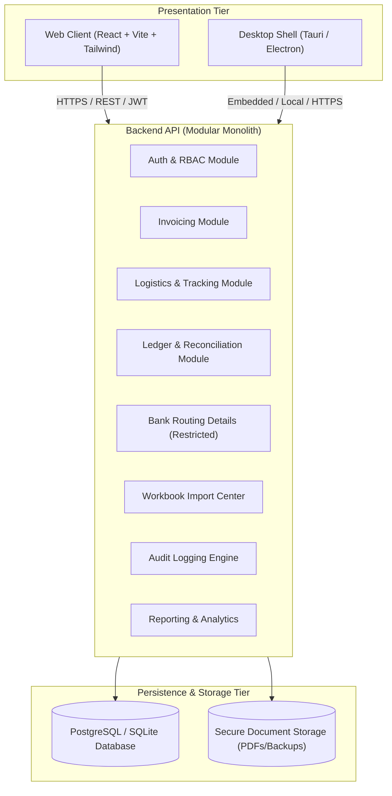

# AQ Companies Logistics & Financial Management System
## System Architecture Specification

### 1. Architectural Philosophy
The system is implemented as a **Modular Monolith** with clear bounded contexts, unified authentication, strong database invariants, and decoupled presentation tiers.

### 2. Client Tier (Web & Desktop)
- **Shared Codebase**: The frontend is built using **React 18 / Vite / TypeScript** with **Tailwind CSS** for modern, responsive UI design and **Lucide React** for enterprise iconography.
- **Desktop Strategy**: The desktop client packages the exact same responsive React application using a lightweight desktop shell (Tauri / Electron), targeting Windows, macOS, and Linux.
- **Uniform Contract**: Both clients consume identical REST API endpoints authenticated via signed bearer JWTs. No desktop-specific backdoor endpoints exist.

### 3. Backend Architecture
The backend is structured into modular domain services:

1. **Authentication & Authorization**:
   - Issue and verify signed JWT tokens with configurable expiration.
   - Enforce server-side role permission checks using decorators/guards.
   - Session tracking with remote revocation capability.

2. **Ledger & Accounting Engine**:
   - Zero floating-point arithmetic: all money calculations utilize arbitrary precision fixed-point math (`decimal.js`).
   - Deterministic cumulative balance calculator:
     $$\text{Running Balance} = \text{Opening Balance} + \sum \text{Credits} - \sum \text{Debits}$$
     Sorted deterministically by `effective_date ASC, posted_at ASC, id ASC`.
   - Immutable posted ledger entries. Corrections use reversal entries linked by foreign key (`reversal_of_id`).

3. **Invoicing & Commercial Core**:
   - Lifecycle: `DRAFT` $\rightarrow$ `ISSUED` $\rightarrow$ `VOID`.
   - Freeze on issue: issuing an invoice captures an immutable snapshot of banking routing details, consignee details, payment terms, and line items. Subsequent company profile changes never mutate historical documents.
   - Decimal validation: weights and unit prices are strictly validated server-side.

4. **Logistics & Freight Tracking**:
   - Real-time container tracking with carrier, vessel, B/L number, route, and status.
   - Event-driven status history (`shipment_status_history`) recording who changed what and when.
   - Junction table (`shipment_invoices`) providing many-to-many relationship support.

5. **Restricted Banking Core**:
   - Default masking of sensitive financial identifiers (`101502******0472`).
   - Audited reveal endpoint (`POST /bank-accounts/:id/reveal`) requiring high-privilege permissions and generating tamper-evident audit records.

6. **Workbook Import Center**:
   - Direct parsing of `AQ_Companies_System_v10_Logistics.xlsx`.
   - SHA-256 integrity verification.
   - Multi-phase migration: Upload $\rightarrow$ Parse $\rightarrow$ Dry-Run Validation $\rightarrow$ Conflict Resolution $\rightarrow$ Transactional Commit $\rightarrow$ Audit Sign-Off.

### 4. Database Schema & Data Integrity
- Primary keys are immutable **UUIDs** (`v4` or `v7`).
- Foreign keys maintain referential integrity with cascading rules where safe.
- Financial figures are stored using `DECIMAL(18, 4)`.
- ACID transactions guarantee atomicity across multi-table operations (such as payment allocation and invoice issuance).
