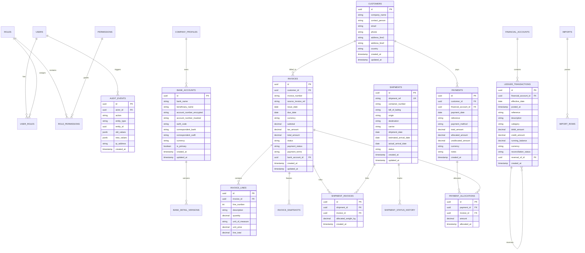

# AQ Companies Logistics & Financial Management System
## Relational Database Schema & Entity Relationship Diagram (ERD)

### 1. Entity-Relationship Diagram

### 2. Table Definitions & Constraints
- **UUID Primary Keys**: Every entity uses a non-sequential, immutable UUID identifier.
- **Decimal Fields**: Financial fields (`debit_amount`, `credit_amount`, `running_balance`, `total_amount`, `unit_price`, `line_total`, `allocated_amount`) use `DECIMAL(18, 4)`.
- **Foreign Keys**: Explicit relational constraints enforce referential integrity across all junction tables.
- **Audit Columns**: `created_at`, `updated_at`, and `created_by` track temporal state changes.
